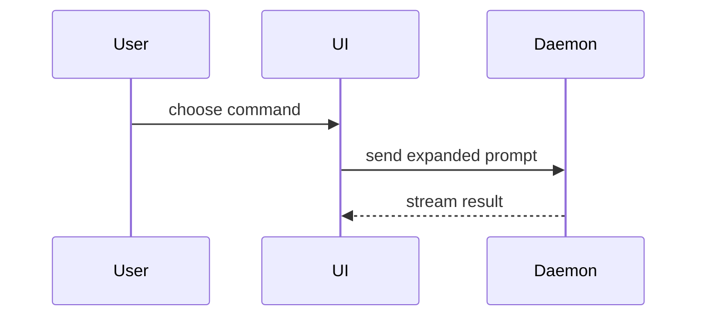

## Core principles

- PR title and description describe ONLY the final state at the head commit of the PR branch (after) vs Base branch (before), not individual commits or review rounds.
- When creating a PR, including as a delegated worker, pass the complete title and body to `gh pr create` using `--title` and `--body` or `--body-file`, so the opening event carries the finished description.

Use this template for writing the PR body:

```markdown
## Summary

<diagram, diff-sketch, or tree>

<details>
<summary>Evidence</summary>

- **Before:** <screenshot/output/failing test run>
  **After:** <screenshot/output/passing test run>

</details>

## Merge Danger

**Door:** <one-way or two-way>

<optional: description>

**Blast Radius:** <one-word description>

<optional: potential ramifications of merge>

## References

- <primary issue, supporting document/report, or companion PR; N/A only when none exist>

<ai-generated-disclaimer>**This PR description was generated by AI. AI can make mistakes**</ai-generated-disclaimer>
```

Apply specifically requested user formatting first. Otherwise, select a repository PR template or use the template above, subject to the Evidence and References rules below:

1. If no repo templates exists or not specifically instructed by user, use skill template above.
2. For an existing description, normalize it to the selected structure. Preserve relevant content, exact references, supplied media references, and required footers only when they follow the principle. Merge duplicate-role sections; move merge-critical content from catch-all sections into Merge Danger.
3. In the selected template or explicitly requested structure, treat headings with equivalent meaning as present (for example, `Description` for summary, `Testing` for evidence, `Risks` for merge danger, or `Links` for references). Fill that heading rather than adding a duplicate section. Preserve retained heading text and order; append only semantically absent sections from the template above.

## Title

Format PR titles as `<change-type>(<primary-issue-id>): <description>`, using the primary issue's ID; with no issue, omit the prefix. Supporting documents, reports, and companion PRs do not supply title prefixes.

## Sections

Skip all preambles and keep prose brief. Use the user's domain language from `GLOSSARY.md`.

Write for a human reviewer who reads the visible body (everything outside `<details>`) in about a minute: at most about 40 visible lines, one or two Summary visuals, and no sections beyond the selected structure. (writing-clearly-and-concisely)

On creation or after pushing commits, reconcile the title and description with the complete branch diff. Update when content not following core principle.

When updating, rewrite the description rather than append to it. NO per-commit result tags, "since last review" blocks, and earlier-revision comparisons. Core principle must be followed.

### Summary

Pick the smallest view that makes the key point clear.

- Show logic or an algorithm as pseudocode:

```text
on(save)
  if content is unchanged
    return cached result
  write new content
  return fresh result
```

- Show runtime control flow as a call tree:

```text
submitForm
  createSession
    persistPrompt
    launchAgent
  navigateToSession
```

- Show UI structure as a component tree, including state and module boundaries that matter:

```text
<SessionPage> (apps/example/src/routes/session.tsx)
  useSessionEvents()
  <SessionToolbar>
    <RunSkillButton> (packages/ui)
```

- Show file responsibility or a broad refactor as a shallow file tree:

```text
src/
├── commands/       # parses user actions
├── sessions/       # owns session state
└── transport/      # sends API requests
```

- Show component interaction, control flow, or data flow with Mermaid:



- Use `diff` when the point is what changes and the surrounding shape already exists. Match the diff shape to the topic.

For a component change:

```diff
 <SessionPage>
   useSessionEvents()
   <SessionToolbar>
+    <RunSkillButton />
   <SessionTimeline>
+    <SkillResultCard />
```

For a file-layout change:

```diff
 src/
 ├── commands/
+│   └── show-me.ts       # expands the slash command
 ├── sessions/
-└── transport.ts
+└── transport/
+    ├── client.ts
+    └── stream.ts
```

For a call-tree or call-stack change:

```diff
 submitForm
   createSession
     persistPrompt
+    expandSkillMention
     launchAgent
-  navigateToSession
+  navigateToSession
+    subscribeToEvents
```

For a state or control-flow change:

```diff
 on(save)
-  write content
+  if content is unchanged
+    return cached result
+  write new content
+  invalidate cache
```

- Show the whole block when most of it is new, when omitted context would hide ownership or order, or when the user needs a copyable target shape:

```ts
function expandSkill(command: string): string {
  const skillName = command.slice(1);
  return `use the ${skillName} skill`;
}
```

#### Guidance

Every Summary includes at least one compact diagram, tree, pseudocode block, or diff sketch explaining the change. Place concise change bullets beside it. Include only details needed by the reviewer.

#### Reviewer help

- Link one companion PR when work spans repositories; keep its details there.
- For a large or mechanical diff, add a short Reviewer Guide: where to start, behavioral risk, one representative bulk file, then docs/tests.
- Cut secondary rationale, behavior catalogs, and API contracts the diff already shows. Use `<details>` only for a short item a reviewer needs; keep merge-critical content visible.

### Evidence

Show concrete before/after proof when observed. Prefer screenshots for visual changes; otherwise use test results or console output.

Use only completed results that still apply to the head. Keep about five behavior-level results, without execution metadata or `Not verified:` placeholders.

Collapse verification in closed `<details>`, preserving the selected heading and position. Keep merge-blocking failures, missing required proof, and pending required CI visible under risks.

Include visual evidence only for user-visible UI changes. Summary diagrams explain the change; screenshots or recordings demonstrate it.

#### UI media routing

For a user-visible UI change, route to `before-and-after` only when the user requests screenshot or recording evidence, or asks for a review-ready published PR. Draft or revise the body first; `before-and-after` coordinates the visual-evidence workflow and owns media attachment, while `agent-browser` owns capture mechanics.

- New PR: draft the body → `gh` creates the PR → `before-and-after` adds the media.
- Existing PR: revise the body if needed, then hand the PR to `before-and-after`; do not create another PR.
- A body-only UI request does not authorize capture or publication. Preserve supplied media references without capturing or publishing media.
- Backend or otherwise non-visible changes do not route to `before-and-after`.

### Merge Danger

Describe whether it's a one-way or two-way door. You can walk back through two-way doors, but not one-way doors. A PR that is cheap to roll back is lower risk. Changes that involve destructive actions or hard-to-reverse decisions are one-way doors.

The blast radius is the potential impact or scope of the changes introduced by this PR. Consider all possibilities. Examples are layout shift, breakages for consumers, mobile responsiveness, etc.

### References

Find references in the supplied/current body, task or conversation, branch name, commits, then companion-change evidence.

List directly relevant issues, documents, reports, and companion PRs. Put the primary issue first; label supporting links. Use References or an equivalent heading, broadening issue-only headings when needed. Keep report links here, not in Evidence.

Preserve supplied URLs exactly. Keep plain issue keys plain; invent no URLs or placeholders. Use `- N/A` only when no relevant references exist.

Include footers only when required by the template, repository guidance or convention, or supplied evidence.
